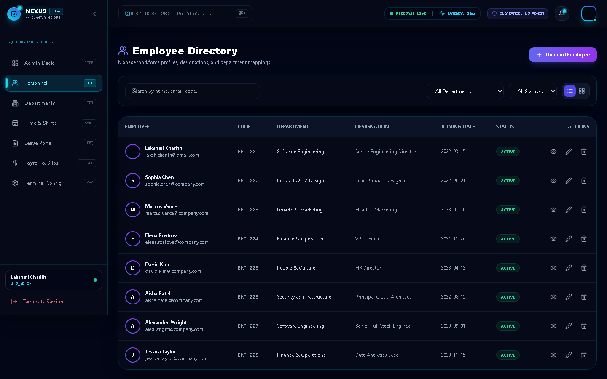
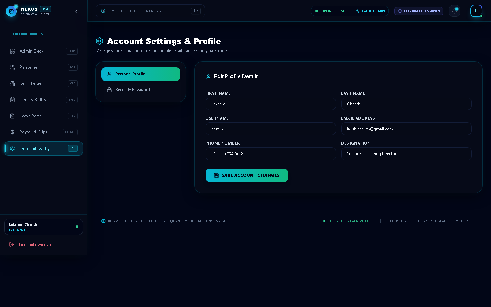
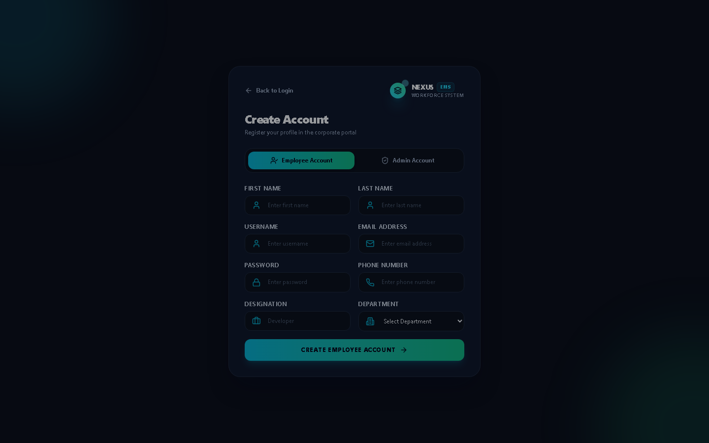

# 🏢 Enterprise Employee Management System (EMS)

[](https://react.dev/)
[](https://tailwindcss.com/)
[](https://vitejs.dev/)
[](https://spring.io/projects/spring-boot)
[](https://www.oracle.com/java/)
[](https://www.mysql.com/)
[](https://opensource.org/licenses/MIT)

A modern, full-stack, enterprise-grade **Employee Management System (EMS)** engineered with high performance, role-based access control (RBAC), real-time attendance tracking, leave request lifecycles, monthly payroll computation, and data export reporting.

Built with a sleek, dark glassmorphism user interface powered by **React 19**, **Tailwind CSS**, and **Framer Motion**, backed by a resilient **Spring Boot 3 (Java 21)** REST API and **MySQL 8**.

---

## 📸 Screenshots Showcase

### 1. Executive Operations Dashboard
Real-time workforce metrics, dynamic KPI cards, staff directory preview, and quick access navigation.


---

### 2. Employee Directory
Interactive employee catalog featuring instant multi-attribute search, department filters, status badges, and management actions.


---

### 3. Department Management
Organizational units overview displaying department head assignments, descriptions, and active headcount statistics.


---

### 4. Attendance & Time Tracking
Shift clock-in/clock-out tracking, real-time live clock, and comprehensive daily employee logs.


---

### 5. Leave Management & Approval Portal
Leave balances (Casual, Sick, Annual, Maternity), status tracking (Pending, Approved, Rejected), and request workflows.


---

### 6. Payroll & Salary Disbursals
Automated payroll computation, basic salary, performance bonuses, tax deductions, net payout, and payslip generation.


---

### 7. Reports & Export Center
Workforce reporting center with instant export to CSV and formatted Microsoft Excel (.xlsx) workbooks.


---

### 8. Account & Security Settings
User profile updates, contact details configuration, and password security management.


---

### 9. Secure Authentication
Modern glassmorphic authentication system supporting dual-role login (Administrator / Employee).


---

### 10. User Registration
Streamlined onboarding form for new team members with validation.


---

## ✨ Key Features

- **🛡️ Role-Based Access Control (RBAC):**
  - **Administrator:** Full administrative rights to manage employees, departments, approve leaves, run payrolls, and export reports.
  - **Employee:** Dedicated self-service portal to clock in/out, view personal attendance, submit leave requests, view payslips, and manage profiles.
- **⚡ Modern Dark Glassmorphic UI:** Smooth Framer Motion transitions, responsive Tailwind CSS layouts, Lucide icons, and toast notifications.
- **👥 Complete Workforce Directory:** Search by name, designation, email, or employee code with full pagination and CRUD modals.
- **🏢 Organizational Units:** Track department heads, team size distribution, and department responsibilities.
- **⏱️ Shift & Attendance Tracking:** One-click clock-in and clock-out with live timestamping and historical audit logs.
- **🌴 Leave Request Workflow:** Employee leave requests with status progression (Pending ➔ Approved / Rejected) and leave quota balances.
- **💰 Monthly Payroll Automation:** Flexible salary structures factoring in base pay, bonuses, and deductions with receipt generation.
- **📊 Reporting & Data Export:** One-click data exports to CSV and Microsoft Excel (.xlsx) utilizing Apache POI.
- **🔒 Enterprise Security:** Stateless JWT authentication (JSON Web Tokens), BCrypt password hashing, and Spring Security method-level protection.

---

## 🛠️ Technology Stack

### Frontend
- **Framework:** React 19 (Vite 5)
- **Styling:** Tailwind CSS 3, PostCSS, Autoprefixer
- **Icons & UI:** Lucide React, React Icons, Framer Motion
- **State & Data:** Axios with resilient fallback interceptor, React Query, React Hook Form
- **Feedback:** React Hot Toast, SweetAlert2
- **Routing:** React Router v6

### Backend
- **Framework:** Spring Boot 3.3.2 (Java 21)
- **Security:** Spring Security 6, JJWT (io.jsonwebtoken 0.12.5)
- **Persistence:** Spring Data JPA, Hibernate, MySQL Connector/J
- **Document Processing:** Apache POI 5.2.5, OpenCSV 5.9
- **Validation:** Hibernate Validator, Jakarta Validation

### Database
- **Engine:** MySQL 8.0+
- **Schema:** Relational design with foreign keys, indexes, and cascades (`database/schema.sql`)

---

## 🚀 Getting Started

### Prerequisites
- **Node.js:** v18+ (Node v20+ recommended)
- **Java:** JDK 21
- **Maven:** 3.8+
- **MySQL:** 8.0+

---

### 1. Database Setup
1. Start your local MySQL service.
2. Execute the provided SQL schema:
   ```bash
   mysql -u root -p < database/schema.sql
   ```
   *This automatically creates `ems_db`, tables, and initial default roles.*

---

### 2. Backend Setup
1. Navigate to the backend directory:
   ```bash
   cd backend
   ```
2. Configure your MySQL credentials in `src/main/resources/application-dev.yml`:
   ```yaml
   spring:
     datasource:
       url: jdbc:mysql://localhost:3306/ems_db?useSSL=false&serverTimezone=UTC&allowPublicKeyRetrieval=true
       username: root
       password: your_password
   ```
3. Run the Spring Boot application:
   ```bash
   mvn spring-boot:run
   ```
   *The backend will start at `http://localhost:8080`.*

---

### 3. Frontend Setup
1. Navigate to the frontend directory:
   ```bash
   cd frontend
   ```
2. Install dependencies:
   ```bash
   npm install
   ```
3. Start the development server:
   ```bash
   npm run dev
   ```
4. Open [http://localhost:3000](http://localhost:3000) in your browser.

---

## 📸 Re-generating Screenshots

To capture fresh high-resolution screenshots of all pages:
```powershell
.\take_screenshots.ps1
```
*Screenshots will be automatically saved directly into the `screenshots/` directory.*

---

## 📂 Project Structure

```text
employee-management-system/
├── backend/
│   ├── src/main/java/com/emp/ems/
│   │   ├── config/              # Security and Web configuration
│   │   ├── controller/          # REST API endpoints
│   │   ├── dto/                 # Request & Response Data Transfer Objects
│   │   ├── model/               # JPA Entities (Employee, Department, Attendance, etc.)
│   │   ├── repository/          # Spring Data JPA Repositories
│   │   ├── security/            # JWT Token Provider and Auth Filters
│   │   └── service/             # Business Logic & Service Implementations
│   ├── src/main/resources/
│   │   ├── application.yml      # Base configuration & JWT secrets
│   │   └── application-dev.yml  # Database datasource properties
│   └── pom.xml                  # Maven dependencies & build plugins
├── database/
│   └── schema.sql               # Complete MySQL DDL & seed script
├── frontend/
│   ├── src/
│   │   ├── components/          # Reusable UI components (Navbar, Sidebar, Logo)
│   │   ├── context/             # React AuthContext & Global state
│   │   ├── layouts/             # App shell & dashboard layouts
│   │   ├── pages/               # Views (Dashboard, Employees, Attendance, etc.)
│   │   └── services/            # Axios API clients & mock data fallbacks
│   ├── index.html
│   ├── package.json
│   ├── tailwind.config.js
│   └── vite.config.js
├── screenshots/                 # Application visual screenshots
├── take_screenshots.ps1         # Automated headless screenshot capture script
├── .gitignore                   # Git ignore rules
└── README.md                    # Project documentation
```

---

## 👤 Author

- **Lakshmi Charith**
- GitHub: [@LakshmiCharith](https://github.com/LakshmiCharith)

---

## 📄 License

This project is licensed under the MIT License - see the [LICENSE](LICENSE) file for details.

